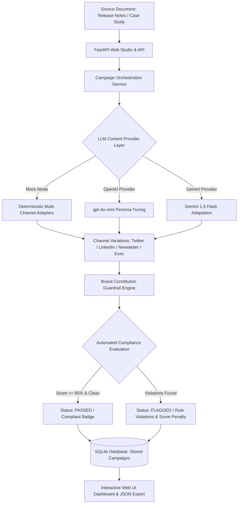

# OmniBrand Copilot ✨🎨

> **Multi-Channel Content Automation Studio with Automated Brand Constitution Guardrails.**

[](https://github.com/Spizhy/omni-brand-copilot/actions)
[](LICENSE)
[](https://python.org)
[](https://fastapi.tiangolo.com)
[](#interactive-web-studio)

---

## 🎯 GitHub Metadata
- **Description**: Full-stack marketing content automation studio converting long-form engineering releases into synchronized multi-channel social campaigns with automated brand compliance guardrails.
- **Topics**: `content-automation`, `brand-guardrails`, `marketing-automation`, `fastapi`, `tailwind-css`, `social-media-automation`, `ai-studio`, `python`
- **Suggested Commit**: `feat: complete OmniBrand Copilot studio with multi-channel generation, brand constitution evaluator and web dashboard`

---

## 📌 Problem Statement
Marketing and developer advocacy teams struggle to convert dense engineering assets (release notes, architectural papers, customer case studies) into synchronized campaigns across Twitter/X threads, LinkedIn updates, technical newsletters, and executive briefings. 

Common bottlenecks:
1. Re-formatting for individual channel length, hooks, and hashtags takes hours.
2. Unchecked AI outputs often hallucinate claims or slip in banned marketing fluff ("game-changing", "revolutionary", "disruptive").
3. Content breaches brand tone or makes disparaging remarks about competitors, posing compliance risk.

**OmniBrand Copilot** is a full-stack automated studio:
- Deconstructs long-form source text into channel-optimized narrative threads.
- Evaluates drafts against an automated **Brand Constitution** (banned buzzword checks, length constraints, competitor non-disparagement).
- Serves an embedded **Glassmorphic Single-Page Application (SPA)** with zero npm build dependencies, running out-of-the-box in seconds!

---

## 🏛️ Architecture



---

## ✨ Features
- **Instant Browser UI (< 2 Minutes)**: Built with modern Tailwind CSS and Alpine/JS via CDN. No Node/npm installation or compilation required.
- **Multi-Channel Adapters**: Generates formatted Twitter/X threads (with tweet chunking), LinkedIn posts (with storytelling hooks & tags), Newsletter digests, and Executive briefs.
- **Brand Constitution Guardrails**: Enforces compliance by screening banned hype buzzwords, competitor disparagement, and character bounds.
- **Real-Time Audit Scorecard**: Provides an overall compliance percentage (0–100%) and pinpointed violation alerts.
- **Pluggable LLM Provider**: Switch between `mock`, `openai`, and `gemini` via environment variables. Runs 100% offline out-of-the-box.
- **Dockerized & CI-Tested**: Includes Dockerfile, `docker-compose.yml`, and GitHub Actions workflow.

---

## 🚀 Quick Start (< 2 Minutes)

### 1. Installation
```bash
git clone https://github.com/Spizhy/omni-brand-copilot.git
cd omni-brand-copilot

python -m venv venv
source venv/bin/activate  # On Windows: venv\Scripts\activate

pip install -r requirements.txt
```

### 2. Run the Studio Server
```bash
python -m uvicorn app.main:app --host 0.0.0.0 --port 8002 --reload
```
Open **[http://localhost:8002](http://localhost:8002)** in your browser to launch the interactive studio!

---

## 💻 Interactive Web Studio

The studio provides:
1. **Source Document Input**: Paste notes or click **"+ Load Sample Notes"**.
2. **Channel Checkboxes**: Select Twitter Thread, LinkedIn Post, Newsletter, Executive Brief.
3. **1-Click Generation**: Computes all channel variations and executes the compliance audit.
4. **Live Guardrail Card**: Displays pass/fail status and compliance score.
5. **Channel Tabs**: Easily review and copy text directly to your clipboard.

---

## 📡 API Usage Examples

### 1. Generate Multi-Channel Campaign via REST API
```bash
curl -X POST "http://localhost:8002/api/v1/campaigns" \
  -H "Content-Type: application/json" \
  -d '{
    "source_text": "Release 2.4: Real-Time Ledger Reconciliation with 2-way and 3-way matching.",
    "campaign_title": "Ledger Reconciliation v2.4",
    "target_channels": ["TWITTER_THREAD", "LINKEDIN_POST"]
  }'
```

### 2. Verify Custom Content against Guardrails
```bash
curl -X POST "http://localhost:8002/api/v1/verify" \
  -H "Content-Type: application/json" \
  -d '{
    "channel": "LINKEDIN_POST",
    "content": "This game-changing release is a revolutionary miracle."
  }'
```

---

## ⚙️ Configuration Reference

| Variable | Default | Description |
|----------|---------|-------------|
| `LLM_PROVIDER` | `mock` | Active provider (`mock`, `openai`, `gemini`) |
| `LLM_MODEL` | `gpt-4o-mini` | LLM model name |
| `MIN_COMPLIANCE_SCORE_PERCENT` | `85.0` | Minimum score to qualify as brand compliant |
| `STRICT_BUZZWORD_FILTER` | `true` | Enforce prohibition on hyperbolic hype words |
| `DATABASE_PATH` | `data/omni_brand.sqlite3` | SQLite database file location |

---

## 🧪 Running Tests
```bash
pytest tests/ -v
```

---

## 📂 Project Structure
```
omni-brand-copilot/
├── app/
│   ├── config.py              # Pydantic BaseSettings
│   ├── guardrails/
│   │   ├── brand_rules.py     # Brand constitution & banned words
│   │   └── evaluator.py       # Compliance verification engine
│   ├── main.py                # FastAPI routes & static web studio
│   ├── models/
│   │   ├── database.py        # SQLite campaign persistence
│   │   └── schemas.py         # Data schemas
│   ├── providers/
│   │   ├── base.py            # Abstract provider
│   │   ├── mock_provider.py   # Deterministic multi-channel engine
│   │   ├── openai_provider.py # OpenAI integration
│   │   └── gemini_provider.py # Gemini integration
│   ├── services/
│   │   └── campaign_generator.py # Multi-channel campaign pipeline
│   ├── static/
│   │   └── index.html         # Glassmorphic single-page web app
│   └── utils/
│       └── logger.py
├── tests/
│   ├── test_guardrails.py
│   ├── test_generator.py
│   └── test_api_integration.py
├── Dockerfile
├── docker-compose.yml
├── requirements.txt
└── README.md
```

---

## 🗺️ Roadmap
- [x] Zero-build Glassmorphic Web Studio UI
- [x] Automated Brand Constitution Guardrail evaluator
- [x] Multi-channel persona generation (Twitter, LinkedIn, Newsletter, Exec)
- [x] SQLite campaign persistence & audit scorecards
- [ ] Direct publishing integration with Buffer and Typefully APIs
- [ ] Image generation prompt synthesizer for social banners

---

## 📄 License
Released under the [MIT License](LICENSE).
